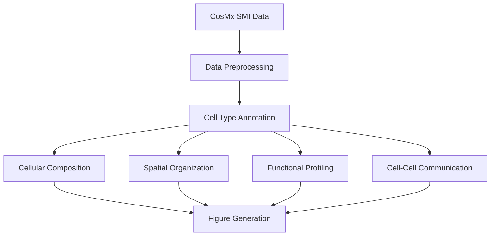

# Spatial transcriptomics of regional response heterogeneity in rectal cancer after neoadjuvant treatment


## Overview

This repository provides analytical workflows and source code associated with the manuscript entitled **"Spatial transcriptomics of regional response heterogeneity in rectal cancer after neoadjuvant treatment."**

This study investigates regional heterogeneity in treatment response within a single rectal cancer specimen using the CosMx Spatial Molecular Imager (SMI), focusing on cellular composition, spatial organization, functional alterations, and cell–cell communication in the tumor microenvironment.

## Study Objectives

- Characterize cellular heterogeneity across treatment response regions.
- Investigate the spatial organization of tumor and stromal cells.
- Identify region-specific transcriptional and functional alterations.
- Explore spatially associated cell–cell communication.

## Analysis Workflow



## Repository Structure

```text
RectalCancer-CosMx/
├── scripts/
│   ├── 00_Run_all_figures.R
│   └── README.md
├── metadata/
│   └── README.md
├── figures/
│   └── README.md
├── .gitignore
├── LICENSE
└── README.md
```

## Software Environment

The analytical workflow was implemented in R.

Detailed software versions, package dependencies, and reproducibility documentation will be updated.

## Data Availability

The GEO accession number will be updated once available.

## Code Availability

The R source code used to generate the main and supplementary figures is publicly available in this repository.

- [Analysis scripts](./scripts/)
- [Integrated figure-generation script](./scripts/00_Run_all_figures.R)
- [Analysis instructions](./scripts/README.md)

## Citation

Spatial transcriptomics of regional response heterogeneity in rectal cancer after neoadjuvant treatment.

Manuscript and citation information will be updated upon publication.

## License

The source code is distributed under the MIT License.

## Contact

**Junho Kang, Ph.D.**

Keimyung University Dongsan Medical Center, Republic of Korea

- Email: junho6399@dsmc.or.kr
- [Personal Website](https://kangjunho.github.io/Kangsin/)
- [Research & Code](https://kangjunho.github.io/Kangsin/research-code.html)
