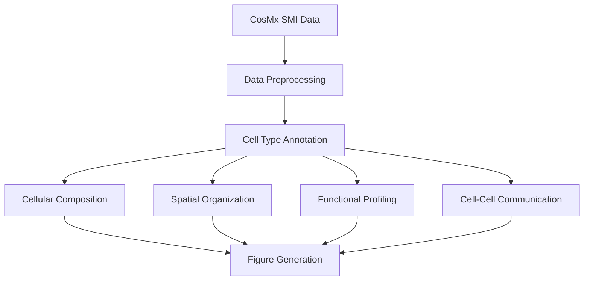

# Rectal Cancer Spatial Transcriptomics

### Spatial heterogeneity of treatment response using CosMx SMI


## Overview

This repository is intended to provide reproducible analytical
workflows and source code for the spatial transcriptomic
characterization of heterogeneous treatment response in
rectal cancer using the CosMx Spatial Molecular Imager (SMI).

The study investigates histologically distinct response and
non-response regions within a single rectal cancer specimen,
with a focus on cellular composition, spatial organization,
functional alterations, and cell–cell communication within
the tumor microenvironment.

## Study Objectives

- Characterize cellular heterogeneity across treatment
  response regions.
- Investigate the spatial organization of tumor and
  stromal cells.
- Identify region-specific transcriptional and functional
  alterations.
- Explore spatially associated cell–cell communication.

## Analysis Workflow



## Repository Structure

Planned repository organization:

```text
RectalCancer-CosMx/
├── scripts/
├── metadata/
├── figures/
├── README.md
├── LICENSE
├── CITATION.cff
├── sessionInfo.txt
└── renv.lock
```

## Software Environment

The analytical workflow was implemented in R.

Detailed software versions, package dependencies, and
instructions for reproducing the analyses will be provided
with the source code.

## Data Availability

GEO accession information will be updated once available.

## Code Availability

Analysis scripts are being prepared for public release
through this repository.

## Citation

Manuscript and citation information will be updated
upon publication.

## License

The source code is distributed under the MIT License.

## Contact

**Junho Kang, Ph.D.**

Keimyung University Dongsan Medical Center,
Republic of Korea

- Email: junho6399@dsmc.or.kr
- [Personal Website](https://kangjunho.github.io/Kangsin/)
